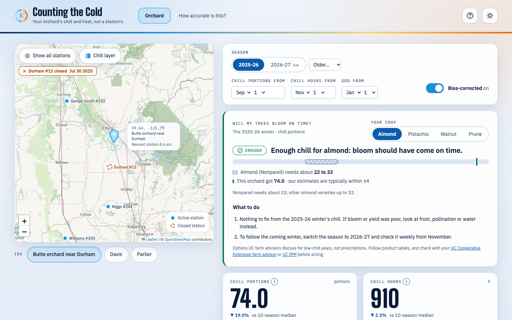
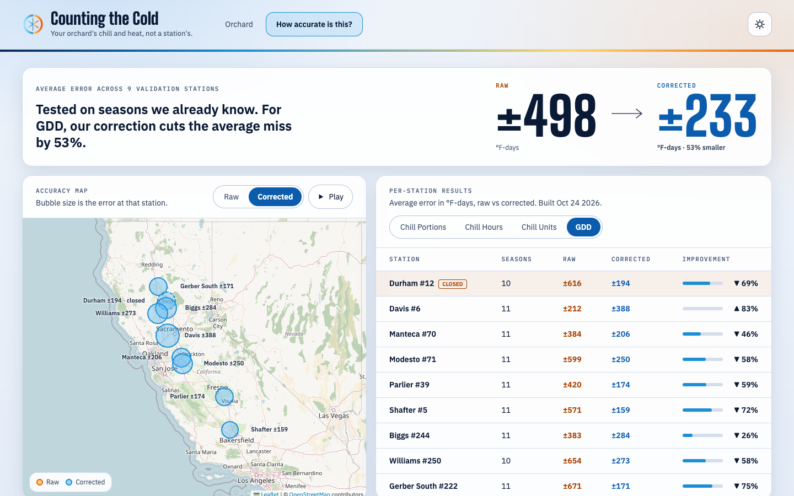
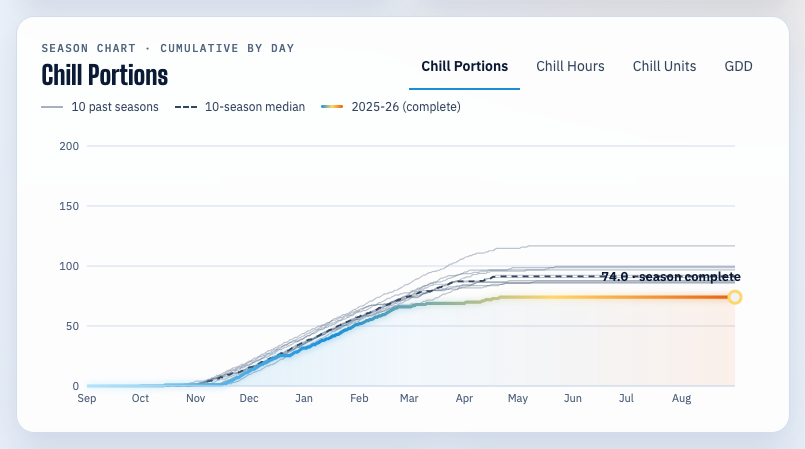
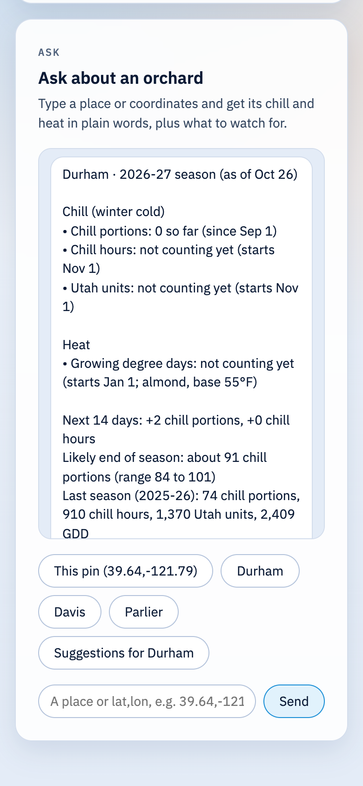
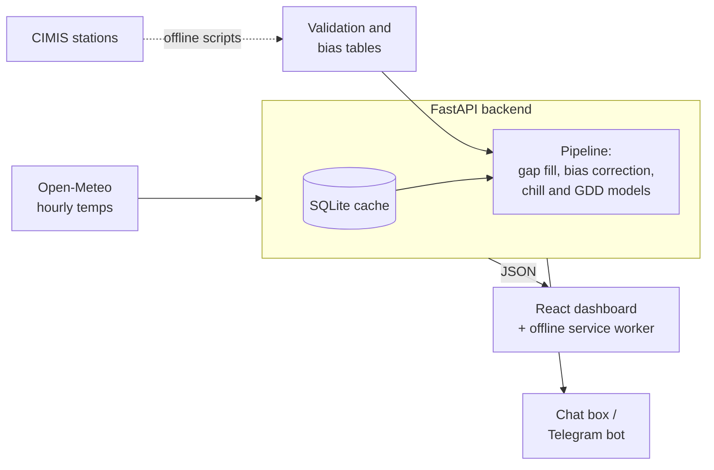

# Counting the Cold

**Winter chill and heat for any California orchard, not just the nearest weather station.**

🏆 **2nd Overall, 1st in Track, Reboot Earth California @ UC Davis 2026** (UC Davis FNRIC "Counting the Cold" challenge)

**Live demo:** [counting-the-cold.vercel.app](https://counting-the-cold.vercel.app) · **API docs:** [counting-the-cold-api.vercel.app/docs](https://counting-the-cold-api.vercel.app/docs) · **Pitch Deck:** https://canva.link/j4odddhhjhoplp1<!-- add the video link here -->

## The problem

Fruit and nut trees need a set amount of winter cold ("chill") before they bloom well, and spring heat (growing degree days) drives bloom, pests and harvest. A short winter is expensive: California lost about half its pistachio crop in 2015 after a warm winter.

Growers track both from CIMIS weather stations, but stations are sparse, sit in different microclimates, and close. Durham #12 in Butte County shut down in July 2025. UC Davis's Fruit & Nut Research & Information Center (FNRIC) asked for a way to estimate chill and heat for any orchard, and to show how far to trust the estimate.

## The solution

Drop a pin on any California orchard and get its chill and heat for the season, from gridded hourly weather data validated against real stations.

- **"Will my trees bloom on time?":** pick almond, pistachio, walnut or prune and get a verdict (on track, watch closely, at risk) from the orchard's chill against UC's published chill needs, plus crop-specific next steps for a short winter. The same crop choice sets the heat numbers (UC IPM pest models), and a short guide walks first-time visitors through it. Added after judge feedback.
- **Four standard models:** chill portions (Dynamic Model), chill hours, Utah chill units and growing degree days, the same ones FNRIC uses. Chill hours and Utah units reproduce FNRIC's published daily values exactly (24 station-seasons).
- **This winter vs the last 10:** a cumulative chart and season totals show early when a winter is running short.
- **Forecast and outlook:** a 16-day forecast plus a likely end-of-season range based on the last 10 seasons.
- **Honest accuracy:** every number shows its typical error, from leave-one-station-out validation against 9 CIMIS stations (97 station-seasons). A station bias correction cuts heat (GDD) error roughly in half, from 498 to 233.
- **Works where stations don't:** a closed station's decade of records still calibrates the orchards around it.
- **Offline phone mode:** an installable web app that keeps the last 5 orchards viewed, so it opens in the field with no signal.
- **Text-style chat:** type "durham" or "39.64,-121.79" and get a plain-language summary plus things to watch for. The same replies power a Telegram bot.
- **Statewide chill map and open API:** a Central Valley chill layer, and a public `/api/v1/models` endpoint other sites can embed.

## Screenshots

| Orchard dashboard | Accuracy map |
|---|---|
|  |  |
| **This winter vs the last 10** | **Ask about an orchard (phone)** |
|  |  |

## Tech stack

- **Backend:** Python 3.12, FastAPI, pandas, NumPy, Pydantic, SQLite cache, pytest (183 tests)
- **Frontend:** React 19, TypeScript, Vite, React Leaflet, Recharts, a service worker for offline mode
- **Data:** Open-Meteo hourly archive and forecast, CIMIS station data (validation only)
- **Infrastructure:** Vercel (API and site), GitHub Actions CI

## Architecture

The API fetches hourly temperatures for the pin, fills short gaps, applies the station bias correction to heat, runs the models for this season and the last 10, and returns one JSON response that the dashboard renders. Upstream responses are cached in SQLite, and saved snapshots of the demo pins cover outages. CIMIS data is used offline only, to build the validation and correction tables.



More detail: [API contract](docs/api-contract.md) · [deployment and bot setup](docs/deploy.md) · [hackathon build plan](docs/BUILD_PLAN.md)

## Run it locally

Needs Python 3.12+ and Node 22+.

```bash
cp .env.example .env
```

Backend on http://localhost:8000 (API docs at `/docs`):

```bash
cd backend && python3 -m venv .venv && source .venv/bin/activate && pip install -r requirements.txt && uvicorn app.main:app --reload
```

Frontend on http://localhost:5173 (proxies `/api` to the backend):

```bash
cd frontend && npm install && npm run dev
```

No backend? `VITE_USE_MOCK=1 npm run dev` runs the frontend on synthetic data. Checks: `cd backend && pytest` and `cd frontend && npm run build`.

**Environment variables** (all optional for local use, see [`.env.example`](.env.example)):

| Variable | What it does |
|---|---|
| `ALLOWED_ORIGINS` | Origins allowed by CORS (default `http://localhost:5173`) |
| `DEMO_MODE` | `1` serves saved snapshots of the demo pins, no network needed |
| `CIMIS_KEY` | Only for the offline CIMIS download script |
| `TELEGRAM_BOT_TOKEN` | Only to run the Telegram bot |
| `VITE_API_URL` | Frontend only: the backend URL in production (empty in dev) |

## What I'd build next

- Proactive alerts when an orchard's chill falls behind normal
- A machine-learning correction for chill, shipped only if it beats the current error
- Higher-resolution data (PRISM, 800 m) to catch frost pockets and microclimates
- More crops and varieties (cherries, peaches, plums) and shareable links to a specific orchard
- The bloom verdict in the chat and Telegram replies

## Author

**Krish Sharda** · [GitHub](https://github.com/Chuckisawsome12345) · [LinkedIn](https://www.linkedin.com/in/krishsharda/)

Built in 24 hours with teammates [@karthikmaheshwaran](https://github.com/karthikmaheshwaran) and [@Zooomer69](https://github.com/Zooomer69). Licensed under [MIT](LICENSE).
